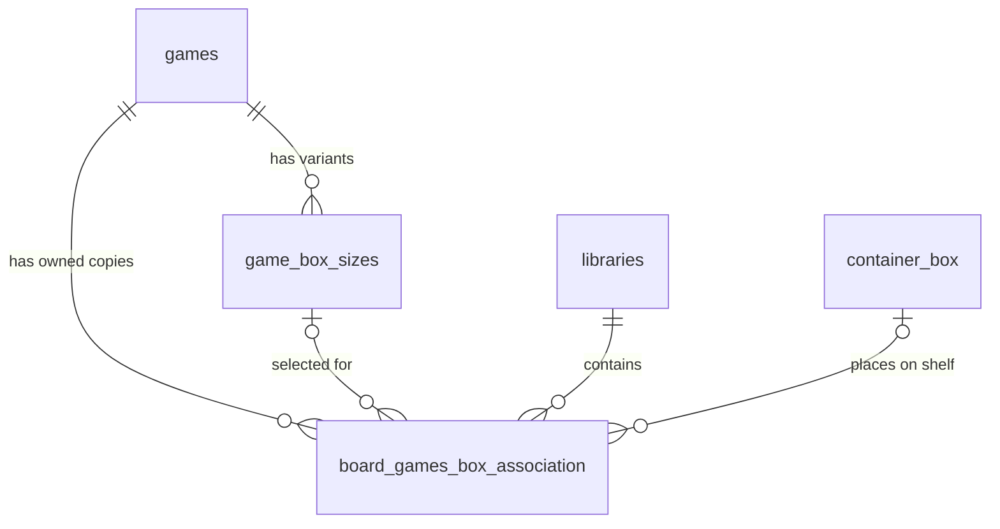

# Kallboard

Kallboard is a platform for managing and tracking your board game collection.

## Roadmap

### Now: complete the Supabase integration

- [ ] Make the database reproducible with migrations for profiles, libraries,
  reviews, voting sessions, and votes.
- [ ] Add and verify Row Level Security policies for every user-owned resource.
- [ ] Finish authentication and profile flows, including session recovery and
  useful loading and error states.
- [ ] Complete collection persistence: add, edit, remove, favorite, and track
  owned games and play counts.
- [ ] Generate and use up-to-date Supabase database types throughout the app.
- [ ] Cover the main authenticated data flows with tests.

### Next: desktop UI

- [ ] Rework the desktop layout, navigation, spacing, and information density.
- [ ] Improve the collection and game-detail views for larger screens.
- [ ] Refine the Kallax-style shelf, including box dimensions and horizontal,
  vertical, and side orientations.
- [ ] Keep the layouts responsive and accessible across desktop and mobile.

### Later: community features

- [ ] Finish game reviews.
- [ ] Complete Spotify Jam-style sessions for voting on which game to play.
- [ ] Add event organization and lobbies.
- [ ] Add groups, with clans considered after the core social flows are proven.

### Later: dedicated backend service

Develop a first-party backend service once the Supabase integration and core
product flows are stable. Introduce it incrementally for workloads that benefit
from custom server-side logic while retaining Supabase where it remains useful.

- [ ] Define which responsibilities should move behind the backend API.
- [ ] Design authentication, authorization, and data-access boundaries.
- [ ] Implement, deploy, and monitor the service.
- [ ] Migrate features incrementally without disrupting the existing app.

### Later: review topic modelling

Integrate the ABAE-based model from
[boardgames-aspect-extraction](https://github.com/Ubriacopo/boardgames-aspect-extraction)
to recognize the aspects discussed in board game reviews. Extracted topics will
help organize and filter reviews by themes such as components, mechanics, and
complexity.

- [ ] Package preprocessing and ABAE inference as a reproducible service.
- [ ] Define a stable topic taxonomy and map model outputs to readable labels.
- [ ] Run topic extraction when reviews are created or updated.
- [ ] Store topic assignments and confidence scores in Supabase.
- [ ] Add topic filters and summaries to the review UI.
- [ ] Evaluate predictions on real reviews before enabling the feature by
  default.

## Setup

Create a `.env` file in the project root:

```dotenv
VITE_SUPABASE_URL=https://your-project.supabase.co
VITE_SUPABASE_PUBLISHABLE_KEY=your-publishable-key
```

The variable names intentionally remain compatible with the previous Vite app.
The start and build scripts generate Angular's local environment module from
these values. Only a Supabase publishable key belongs in this client-side file;
never use a secret or service-role key.

Install and run:

```bash
npm install
npm run dev
```

Open `http://localhost:4200`.

For access from another device on the same network, run the shared WebStorm
configuration **Kallboard LAN**, or `npm run dev:lan`. It listens on all interfaces
on port 4200; Angular prints the network URLs in the terminal. Open
`http://<your-PC-LAN-IP>:4200` on the other device. Stop an existing local server
on port 4200 before launching this configuration.

On Windows, run `./scripts/enable-lan-firewall.ps1` once from an administrator
PowerShell to allow TCP 4200 from local subnets. The rule also works when Windows
classifies the network as Public. Remove it with
`Remove-NetFirewallRule -Name Kallboard-Dev-LAN-TCP-4200` from an administrator
PowerShell when no longer needed. Network client isolation can still prevent
devices from connecting to one another.

## Commands

- `npm run dev` — start Angular's development server
- `npm run build` — create a production bundle in `dist/boardgames-manager`
- `npm test` — run Angular tests
- `npm run backfill:bgg-images` — run the existing BGG image backfill
- `npm run backfill:search-images` — run the existing search image backfill

## Game catalogue, owned copies, and box sizes

The database separates shared game information from physical copies:

| Table | Purpose |
| --- | --- |
| `games` | One shared definition per BGG game: name, release year, BGG link, and fallback cover. |
| `game_box_sizes` | Reusable box dimensions for an edition and optional country/market. One game can have many variants, such as Retail or Kickstarter deluxe. |
| `board_games_box_association` | One copy owned by `user_id`, with an optional cube and its derived library. Stores the selected size variant, private custom dimensions, favorite flag, capacity units, and shelf order. |



**+** adds an unassigned copy immediately with the game's default box format.
Use **+ special** to open the edition/size selector instead. Choose an existing
variant or enter custom measurements in centimetres (0.1 cm increments). Measurements are stored in millimetres for shelf calculations. You can
publish a named variant with an optional country for other collectors to use.
Published variants are immutable; corrections use a new variant, while personal
adjustments stay on your own copy. No measured variants are fabricated when a
game has none: the custom-size form explicitly identifies its initial values as
estimates.

Under **Default format & voting** in the size editor, collectors can vote for
one format per game, change their vote, or remove it. Admins can set an explicit
default or return to community voting. An admin default takes priority;
otherwise the most-voted format wins, with ties resolved by oldest publication
date and then ID. Defaults apply to future copies only. When no admin choice or
votes exist, quick add leaves the format unset and reports that shelf dimensions
are estimates; it does not publish or save invented measurements.

Apply `supabase/migrations/20261022163000_default_box_formats.sql` with this
frontend. The database validates format/game associations and enforces admin
authority and one vote per user/game through RLS. Run the rollback-only checks
with `npx supabase db query --linked --file supabase/tests/default_box_formats.sql`.

Under an owned game's **Box Dims.** tab, change the variant or customize its
width, height, and depth. Turning off customization restores the selected
variant's dimensions. Each copy can use different measurements; use **Add
another edition or copy** to own several editions of the same game. Kallax
rendering resolves custom measurements first, then the selected variant.

`20261022142359_normalize_game_catalog_and_box_sizes.sql` renames the old
`board_games` table to `board_games_box_association`, extracts shared definitions,
and merges the old placement records into each copy. Existing copy UUIDs,
favorites, custom dimensions, and placements are preserved. The original rows
and placements are retained in the private `migration_archive` schema for
recovery. Older rows without a library remain inaccessible and are not assigned
to another collector. Existing custom dimensions are not published as shared
edition sizes.

Collection reads and writes use the new tables; shared collection access remains
read-only, and writes require ownership. `move_collection_game` handles shelf
moves and ordering atomically. The size/game composite foreign key prevents a
copy from choosing a variant belonging to a different game. Maintenance image
backfills now update `games`. Rebuild/deploy the updated frontend with this
migration: older builds still refer to the removed public table names.

## UI styling

Use the **Library** dropdown to switch between named Kallax libraries, or choose
**+ Create library...** to create one. Switching libraries changes the Kallax
cubes and shelf layout. Collection and New show owned games across all your
libraries, with a chip identifying each copy's library. Enable **Only current
library** in Collection to limit the list to the selected Kallax; the filter stays
selected while navigating within the app. New copies start in the shared
**Unassigned** tray and have no library until placed in a cube. Drag a copy into
any owned Kallax to assign its library; moving it back to Unassigned clears that
membership. Shared collections offer a library dropdown as well.

Use **Add another copy** on an owned game's Overview to add with the default
format, or **+ special** to choose another edition or custom measurements.
Each copy has independent dimensions, favorites, and placement.
The new copy starts unassigned. Apply
`supabase/migrations/20261022162000_collection_copy_ownership.sql` alongside this
frontend: it preserves existing owners, clears library membership for unplaced
copies, and protects collection access through owner-based RLS. Legacy copies
without a known owner stay inaccessible. Database regression checks run with
`npx supabase db query --linked --file supabase/tests/collection_copy_ownership.sql`;
fixtures and changes roll back after the checks.

Choose **Color** beside the Library dropdown to save a color for that library,
or select one while creating a library. Its chips appear beside game metadata
in Collection and New, with contrasting text for readability. Apply
`supabase/migrations/20261022161000_library_colors.sql` for saved colors.

Apply `supabase/migrations/20261022160000_allow_multiple_libraries.sql` before
creating additional libraries. It removes the one-library-per-user restriction
and retains an indexed ownership lookup and the existing access policies.

Library navigation remembers the last Kallax, New, or Collection tab during the
current app session. On touch screens, hold a collection row briefly before
dragging it sideways to favorite or remove it; ordinary swipes scroll the list.

Use Tailwind utilities in Angular templates for layout, typography, spacing,
responsive behavior, theme colors, and interaction states, as required by
`AGENTS.md`. Shared UI such as game spines and crop sliders reuses Angular
components or directives with Tailwind utilities. Theme values and document
base styles live in `src/index.css`; `src/App.css` contains only scoped library
overrides, layered image effects, and the cube-sheet animation.

## Display settings

Under **Profile → Appearance → Display zoom**, choose 100%, 110%, 125%, 150%,
175%, or 200%. Changes apply immediately to Kallax labels, game and collection
row text, covers and spacing, and the rest of the interface where supported.
Game titles wrap and rows grow to keep larger text readable. Row metadata hides
when space is limited. **Reset to 100%** restores the default.

The preference is saved in this browser and survives reloads; it does not sync
between devices. It also works alongside browser zoom and your browser's default
font size. The shelf's existing zoom controls still adjust the shelf separately.

## Friends and shared collections

The Friends page has **Followed** and **Followers** tabs. Each collector row shows
a profile picture (or initials), a handle, and a collection link. Use the **+**
button to find people by handle or name and follow them or send a friend request.
Incoming requests appear under Followers; sent requests appear under Followed.
Approved friends appear in both tabs because their connection is mutual.

Set your handle, profile picture, and connection preference under **Profile**.
Pictures accept JPG, PNG, or WebP files up to 5 MB. They are stored in the public
`profile-pictures` bucket, with uploads restricted to each user's own folder.
`20261022134355_profile_pictures.sql` adds the avatar field and upload policy.

Friend requests require acceptance and share collections in both directions.
Following shares the followed collector's collection in one direction. A follower
who you do not follow back can be followed or sent a friend request from their
row to enable collection access. Switching to approval mode stops existing
followers from accessing your collection; approved friendships remain connected.
Connections can be removed from either tab.

Shared collections provide a Kallax view with selectable cubes and a searchable
game list. They are read-only, including game placement and shelf layout.
Public profiles contain no account email addresses.

Apply `supabase/migrations/20261022071931_add_friends_and_collection_sharing.sql`
with the project's normal migration deployment workflow before using these
features. It adds public social profiles, connections, sharing policies, and saved
shelf grid dimensions. Existing collectors receive a generated `player_…` handle
and default to requiring approval; they can personalize their handle in Profile.

## Handles and cover administration

Registration asks for a unique handle using 3–40 lowercase letters, numbers, or
dots. Handles are reserved during account creation, including when email
confirmation is required, and can be changed under Profile. The database
normalizes case and rejects duplicates. Existing generated handles use `player.`
followed by the account identifier until personalized.

Admins can press the cover on a game detail page, choose **Browse image**, and
upload a JPG, PNG, or WebP file up to 5 MB. Drag and zoom the preview to crop it
before saving. Cover overrides are keyed by BGG game
ID in `game_covers`, shared across discovery and collections, and take precedence
over imported images. Uploaded artwork lives in the public `game-covers` bucket.
The cover editor requires a valid BGG game ID.

Admin authority uses the server-controlled `app_metadata.role = "admin"` value in
Supabase Auth. Assign that role through a trusted administrative connection;
users cannot grant it to themselves through profile or registration fields.
After an admin role changes, sign out and back in to refresh the session.
`20261022082322_admin_covers_and_registration_handles.sql` provisions registration
triggers, handle rules, fuzzy collector search, cover tables, and upload policies.

Game detail pages support separate wallpaper artwork behind the cover and title.
Admins can use **Add wallpaper** or **Edit wallpaper** to upload or crop the
background, with a 16:9 crop preset. Wallpapers are stored in `game_wallpapers`
and use the existing artwork Storage bucket. Editing a wallpaper leaves the cover
unchanged. Without a custom wallpaper, the page uses a softened cover backdrop.
The `20261022121801_game_wallpapers.sql` migration provisions the wallpaper table
and admin-only write policies.

Artwork has four independent roles: **cover** for browsing and collection lists,
**logo** for the game page, **wallpaper** for its background, and **box side** for
Kallax spines. Admins can edit each from the game page. Logos and box sides keep
original proportions by default in the crop editor; the page fits logos into
rounded bounds without cropping. Until a logo is uploaded, the page uses its
cover. Shelves use box-side artwork, fall back to wallpaper, then to the cover
when neither is available. The same rules apply to friends' shelves.
Each game box shows its name in readable 0.85rem uppercase text on a centered, rounded white label,
with a border in the active theme’s brand color, following the box's vertical or horizontal orientation.
`20261022122733_game_logos_and_box_sides.sql` adds the logo and box-side tables
with the same admin-only write policies as existing artwork.
